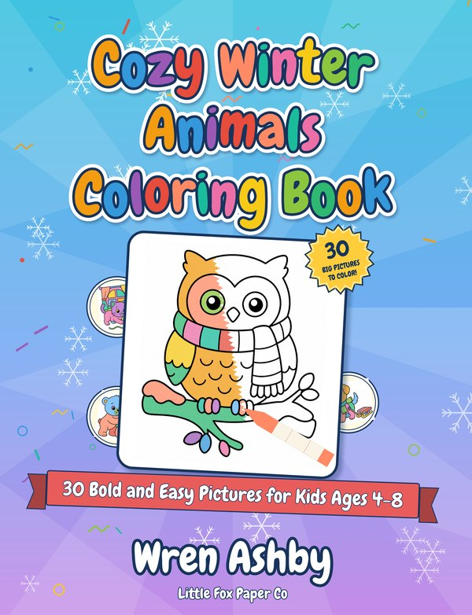
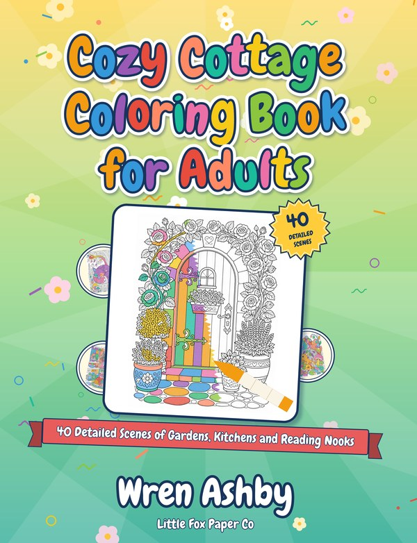
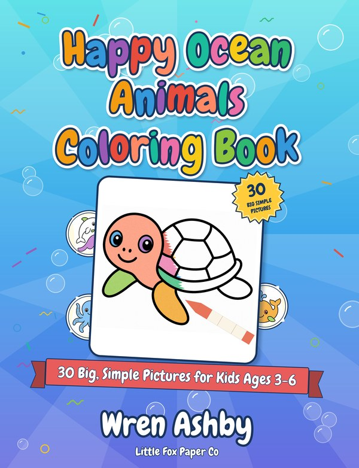

# Little Fox Paper Co: KDP coloring books

A small side project to earn a little toward monthly bills by publishing **coloring books on Amazon KDP** under the imprint **Little Fox Paper Co** (pen name on the books: **Wren Ashby**). Claude prepares the artwork, PDFs, covers and listing text; **the owner uploads and publishes on KDP** (Claude never logs in to KDP or clicks Publish).

**Honest status (2026-11-07):** three books are built and committed. **None is published yet**, and nothing is known about whether they will sell. The topics were picked without sales or competition data, KDP's pages were checked but some form details still need confirming in the KDP form (marked **[verify]**), and most coloring titles earn very little. The plan has stop gates for that reason (see [PLAN.md](PLAN.md)).

## The books

| | Book | For | Pages | Files |
|---|---|---|---|---|
|  | **Cozy Winter Animals Coloring Book** <br> 30 Bold and Easy Pictures for Kids Ages 4-8 | kids 4-8 | 64 | [folder](books/001-cozy-winter-animals) · [listing](books/001-cozy-winter-animals/listing.md) · [interior.pdf](books/001-cozy-winter-animals/final/interior.pdf) · [cover.pdf](books/001-cozy-winter-animals/final/cover.pdf) |
|  | **Cozy Cottage Coloring Book for Adults** <br> 40 Detailed Scenes of Gardens, Kitchens and Reading Nooks | adults | 84 | [folder](books/002-cozy-cottage-adult) · [listing](books/002-cozy-cottage-adult/listing.md) · [interior.pdf](books/002-cozy-cottage-adult/final/interior.pdf) · [cover.pdf](books/002-cozy-cottage-adult/final/cover.pdf) |
|  | **Happy Ocean Animals Coloring Book** <br> 30 Big, Simple Pictures for Kids Ages 3-6 | kids 3-6 | 64 | [folder](books/003-happy-ocean-animals) · [listing](books/003-happy-ocean-animals/listing.md) · [interior.pdf](books/003-happy-ocean-animals/final/interior.pdf) · [cover.pdf](books/003-happy-ocean-animals/final/cover.pdf) |

- **Review status:** book 1 and its cover are approved. Books 2 and 3 are built and waiting for the owner's review.
- **Everything for one book** lives in `books/NNN-slug/final/`: `interior.pdf` and `cover.pdf` (the two KDP uploads), the page images, a cover preview, the cost ledger and a `MANIFEST.md` with checksums. The listing text (title, description, 7 keywords, categories, pricing notes, AI-disclosure answers) is in `books/NNN-slug/listing.md`.
- **To download a file** from GitHub, open it and use the download button (the PDFs are large; book 2's interior is about 16 MB).

## Publishing a book (owner steps, about 10-15 minutes each)

1. Read `listing.md`, check the **[verify]** items in the KDP form, and check that the pen name is free on Amazon (see [TODO.md](TODO.md), section A1).
2. In KDP: create a paperback, paste the listing fields, upload `interior.pdf` (no bleed, 8.5 x 11, black and white, white paper) and `cover.pdf`.
3. Answer **Yes** to AI-generated images (the art is AI-generated; the copyright page and back cover also say so).
4. Check every page in KDP's online previewer. Optionally order a proof copy (recommended for book 2, whose fine texture is the weakest point).
5. Choose a price after seeing KDP's minimum list price and royalty figures, then press Publish.

## Things that matter before you publish

- **Pen name:** books use *Wren Ashby*; the author name cannot be changed after publishing. Whether the adult book should use a second name is an open question.
- **AI disclosure:** required and already built in. Never remove it.
- **Copyright:** purely AI-generated images may not be copyrightable in the US **[verify]**; the "I own the copyright" tick in the form is the owner's call.
- **Money:** KDP's print cost for these books is a flat $2.84, so the royalty at $7.99 is roughly $1.95 per copy (estimate). Reaching a few hundred dollars a month would take many sales.
- **Trademark:** the imprint is always the full "Little Fox Paper Co", never "Little Fox" alone, and the books are not positioned as educational (see [research/](research)).

## How the books are made

```
page ideas -> image generation (OpenRouter, openai/gpt-image-2) -> look at every page -> interior PDF
           -> fun cover with a half-colored crayon look -> listing text -> archive in final/ -> owner uploads
```

| Script | What it does |
|---|---|
| [`scripts/generate_images.py`](scripts/generate_images.py) | Generates pages through OpenRouter's Image API with a hard budget, resume and a cost ledger (`models`, `generate`, `bakeoff`). Needs `OPENROUTER_API_KEY` in the environment; it is never printed or stored. |
| [`scripts/build_interior.py`](scripts/build_interior.py) | Page QA, KDP-spec interior PDF (black and white, 300 DPI, embedded fonts) and cover-size calculator. |
| [`scripts/make_cover.py`](scripts/make_cover.py), [`cover_fun.py`](scripts/cover_fun.py) | The wrap-around cover: gradient, snowflakes/bubbles/flowers, rainbow title, half-colored art with a crayon, badge, ribbon, stickers, blank barcode area. Themes: winter, ocean, garden. |
| [`scripts/archive_book.py`](scripts/archive_book.py) | Copies a finished book into `final/` (grayscale pages, PDFs, ledger, manifest) so it can be committed. |

More detail and example commands: [scripts/README.md](scripts/README.md).

```bash
pip install -r requirements.txt
python3 -m unittest discover -s tests      # 60 tests
```

## What has been spent

About **$2.21 of the $20** image budget (bake-off $0.68, quality tests $0.77, book 1 $0.33, book 2 $0.24, book 3 $0.20). Per-book ledgers are in each `final/` folder.

## Where to read more

| File | What it is |
|---|---|
| [MEMORY.md](MEMORY.md) | Short summary of everything decided so far (read this first) |
| [CLAUDE.md](CLAUDE.md) | Rules that always apply, plus the owner's preferences for covers and workflow |
| [TODO.md](TODO.md) | Owner steps, Claude's status, gates and spending caps |
| [PLAN.md](PLAN.md) | The full plan, research (with sources marked [verify] where unconfirmed) and a dated decision log |
| [research/](research) | Pen-name and trademark checks |
| [`.claude/skills/`](.claude/skills) | Project skills for the book pipeline and the listing writer |

## Branches

`main` is the branch to read: Claude merges finished, owner-approved work into it. Working branches named `claude/...` hold in-progress sessions. (`NEW_SESSION_PROMPT.md` is the original prompt for starting the first build session and is now out of date.)
