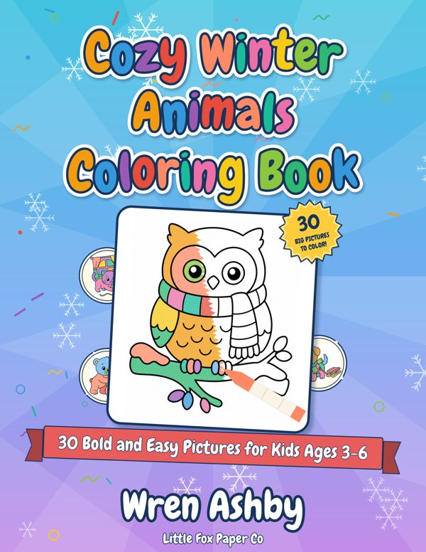
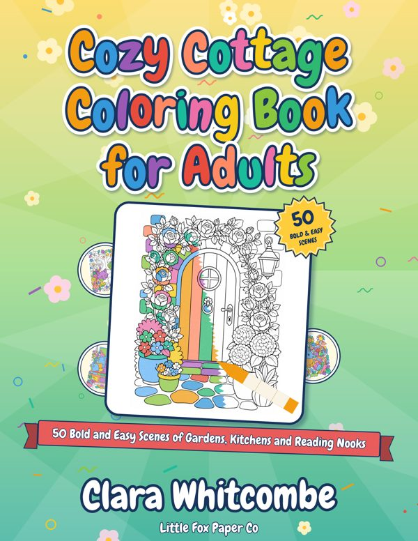
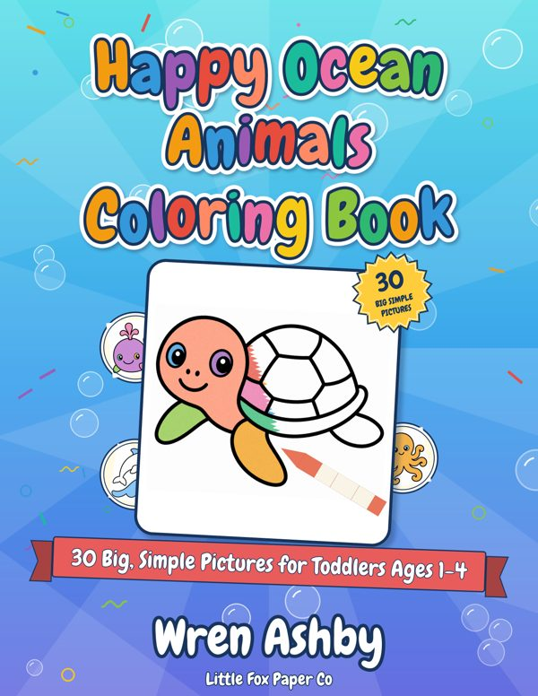

# Little Fox Paper Co: KDP coloring books

A small side project to earn a little toward monthly bills by publishing **coloring books on Amazon KDP** under the imprint **Little Fox Paper Co** (pen name on the books: **Wren Ashby**). Claude prepares the artwork, PDFs, covers and listing text; **the owner uploads and publishes on KDP** (Claude never logs in to KDP or clicks Publish).

**Honest status (2026-11-14):** three books are built and committed. **None is published yet**, and nothing is known about whether they will sell. The topics were picked before any sales or competition research; a research gate now exists for future books. Most coloring titles earn very little; the plan has a kill rule for that reason (see [docs/AUTOPILOT.md](docs/AUTOPILOT.md)).

## The books

| | Book | For | Pictures / pages | Price | Files |
|---|---|---|---|---|---|
|  | **Cozy Winter Animals Coloring Book** <br> 30 Bold and Easy Pictures for Kids Ages 3-6 | kids 3-6 | 30 / 66 | $7.99 | [folder](books/001-cozy-winter-animals) · [upload kit](books/001-cozy-winter-animals/listing.md) · [interior.pdf](books/001-cozy-winter-animals/final/interior.pdf) · [cover.pdf](books/001-cozy-winter-animals/final/cover.pdf) |
|  | **Cozy Cottage Coloring Book for Adults** <br> 50 Bold and Easy Scenes of Gardens, Kitchens and Reading Nooks | adults | 50 / 106 | $9.99 | [folder](books/002-cozy-cottage-adult) · [upload kit](books/002-cozy-cottage-adult/listing.md) · [interior.pdf](books/002-cozy-cottage-adult/final/interior.pdf) · [cover.pdf](books/002-cozy-cottage-adult/final/cover.pdf) |
|  | **Happy Ocean Animals Coloring Book** <br> 30 Big, Simple Pictures for Toddlers Ages 1-4 | toddlers 1-4 | 30 / 66 | $6.99 | [folder](books/003-happy-ocean-animals) · [upload kit](books/003-happy-ocean-animals/listing.md) · [interior.pdf](books/003-happy-ocean-animals/final/interior.pdf) · [cover.pdf](books/003-happy-ocean-animals/final/cover.pdf) |

- **Review status:** all three were rebuilt on 2026-11-14 after an audit and wait for the owner's review. Book 2 was fully regenerated and carries a **placeholder** author name until the owner picks the adult pen name ([research/pen_names.md](research/pen_names.md)).
- **Everything for one book** lives in `books/NNN-slug/final/`: `interior.pdf` and `cover.pdf` (the two KDP uploads), the page images, a cover preview, the cost ledger, `MANIFEST.md` and `UPLOAD_KIT.md`. The same kit is `books/NNN-slug/listing.md`.

## Publishing a book (owner, about 10 minutes each)

Open the book's **upload kit** (`listing.md`) and follow it from top to bottom: it lists the files, every KDP form field in order, the AI-disclosure answers, the categories, the keywords and the price. Order a proof copy for the first book of each style. What to do first is in [TODO.md](TODO.md), section A.

## Things that matter before you publish

- **Pen name:** kids' books use *Wren Ashby*; adult books use a second pen name. The author name cannot be changed after publishing, so search it on Amazon first.
- **AI disclosure:** answer Yes in the KDP form. The copyright page says the illustrations were generated with AI image tools. The back cover does not mention it; the description does.
- **Copyright:** purely AI-generated images may not be copyrightable in the US **[verify]**; the books claim only the selection, arrangement and design.
- **Money:** Amazon.com pays 50% of the list price below $9.99 and 60% from $9.99, minus a $2.84 printing cost for these books. That is **$1.16 per copy at $7.99 and $3.15 at $9.99** (`scripts/kdp_pricing.py`). A few hundred dollars a month would take roughly a hundred sales a month.
- **Trademark:** the imprint is always the full "Little Fox Paper Co", never "Little Fox" alone, and the books are not positioned as educational (see [research/](research)).

## How the books are made

```
research gate -> book.json + page ideas -> book factory (pages, QA, interior, cover, upload kit, archive) -> owner uploads -> sales tracker
```

| Script | What it does |
|---|---|
| [`scripts/research_niches.py`](scripts/research_niches.py) | Collects Amazon search suggestions, ranks niches, merges competitor worksheets into GO / MAYBE / NO verdicts. |
| [`scripts/book_factory.py`](scripts/book_factory.py) | One command per stage from `book.json`: `check`, `pages`, `finish` (writes the upload kit and `final/`). |
| [`scripts/generate_images.py`](scripts/generate_images.py) | Page art through OpenRouter with a required, cumulative budget and a cost ledger. Needs `OPENROUTER_API_KEY` in the environment; it is never printed or stored. |
| [`scripts/build_interior.py`](scripts/build_interior.py) | Page QA and the KDP interior PDF (600 DPI art, embedded fonts, test page). |
| [`scripts/make_cover.py`](scripts/make_cover.py), [`cover_fun.py`](scripts/cover_fun.py) | The wrap-around cover in the owner-approved fun style. |
| [`scripts/kdp_pricing.py`](scripts/kdp_pricing.py) | Printing cost and royalty at any price. |
| [`scripts/sales_tracker.py`](scripts/sales_tracker.py) | Reads the monthly KDP report and applies the kill rule. |
| [`scripts/archive_book.py`](scripts/archive_book.py) | Stores a finished book in `final/`; `--restore` rebuilds the working folder in a new container. |

More detail: [scripts/README.md](scripts/README.md) and [docs/AUTOPILOT.md](docs/AUTOPILOT.md).

```bash
pip install -r requirements.txt
python3 -m unittest discover -s tests      # 109 tests, about 5 minutes
```

## What has been spent

About **$2.80 of the $25** budget for images and proof copies (books $1.35, bake-off $0.68, quality tests $0.77). `python3 scripts/book_factory.py spend books` prints the current total.

## Where to read more

| File | What it is |
|---|---|
| [MEMORY.md](MEMORY.md) | The single current-state file: status, decisions, numbers (read this first) |
| [docs/AUTOPILOT.md](docs/AUTOPILOT.md) | How the system runs with little owner time, what cannot be automated, realistic income |
| [CLAUDE.md](CLAUDE.md) | Rules that always apply, plus the owner's preferences for covers and workflow |
| [TODO.md](TODO.md) | Owner steps, Claude's status, gates and spending caps |
| [PLAN.md](PLAN.md) | History: the original plan and a dated decision log (superseded by MEMORY.md where they differ) |
| [research/](research) | Pen-name and trademark checks |
| [`.claude/skills/`](.claude/skills) | Project skills for the book pipeline and the listing writer |

## Branches

`main` is the branch to read: Claude merges finished, owner-approved work into it. Working branches named `claude/...` hold in-progress sessions. `NEW_SESSION_PROMPT.md` has the short prompt for starting a new session.
